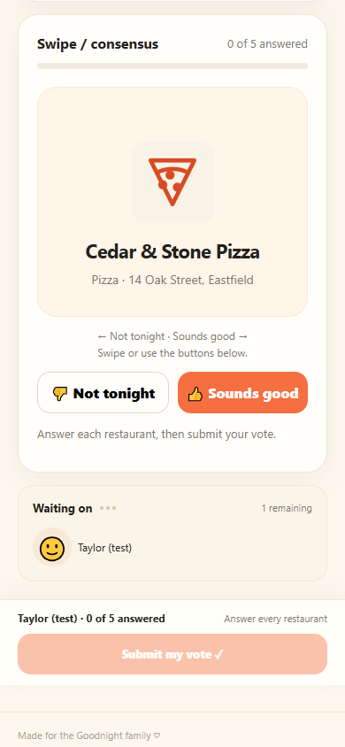
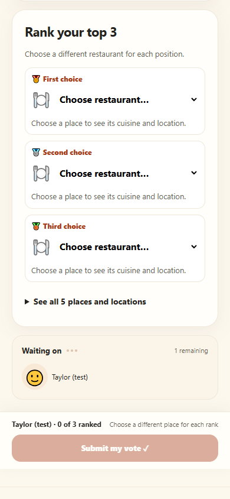

# Goodnights, What's for Dinner? 🍽️

**Stop debating what's for dinner. Let everyone vote.**

Goodnights is a free, mobile-first family restaurant voting app. Save your go-to places, invite the people eating with you, and settle lunch or dinner plans with a quick vote—not a long group-chat debate.

**[Open the family app](https://jacobmgoodnight.github.io/goodnights-whats-for-dinner/)** · [How it works](#how-it-works) · [Voting methods](#choose-how-to-vote) · [Setup & development](#run-it-yourself)

> **This is a family app, not an open public poll.** The hosted site requires a valid organizer or family voting invitation. You can also explore the one-browser local demo or adapt the project for your own household.

## A look at voting

| Swipe / consensus | Ranked choice |
| :---: | :---: |
|  |  |

*Screenshots use fictional restaurants and synthetic browser fixtures, not real family data. See the [mobile UI verification notes](docs/qa/q1-h3/README.md).*

## How it works

1. **🍕 Pick some places.** Choose from saved favorites, search nearby restaurants, or start with a cuisine like pizza or Mexican.
2. **👨‍👩‍👧‍👦 Choose who's eating.** Invite the right family members to a lunch or dinner poll.
3. **📲 Share and vote.** Send a group-chat invitation or personal voting links. Everyone votes on their phone using the selected method.
4. **🏆 Decide together.** Reveal the results after everyone votes, share the winner, and handle ties with a runoff or an optional tiebreaker.

No voter accounts or paid subscriptions required.

## Highlights

- **Three ways to vote:** approval, swipe-style yes/no consensus, and ranked-choice voting.
- **Your restaurant shortlist:** save favorites, search OpenStreetMap, or add places manually—including name/address details copied from Google Maps.
- **Quick dinner themes:** filter saved restaurants for pizza night, Mexican night, and other cuisines; optionally pick five places for a shortlist.
- **Designed for real family groups:** member profiles and avatars, individual reusable links, optional poll-specific group name/avatar selection, and a live “Waiting on…” view.
- **Flexible planning:** review places, participants, and voting rules before starting; reuse a finished dinner as a fresh draft or save organizer presets.
- **Clear results:** restaurant logos or food icons, address and map links, vote summaries, shareable results, and optional organizer-created announcement images.
- **Thoughtful tie handling:** runoffs and one-time random tiebreakers for genuine positive ties. A consensus vote with zero yes responses shows that nobody liked the options instead of inventing a winner.
- **Made for phones:** responsive UI, Add to Home Screen support, and optional organizer notifications after explicit opt-in.

The app prepares invitation, reminder, and result messages for you to review and send. It does **not** automatically text people.

## Choose how to vote

| Method | What voters do | How a winner is chosen |
| --- | --- | --- |
| **👍 Approval** | Pick up to two restaurants | Most approvals wins |
| **👈 Swipe / consensus** | Say yes or no to each place | Most yes votes wins; all-no results remain unresolved |
| **🥇 Ranked choice** | Rank up to three favorites | Instant-runoff tally transfers preferences as lower-ranked candidates are eliminated |

When eligible choices tie, the organizer can start a runoff or use a disclosed, one-time random choice. Voting rules and tie outcomes are saved with the poll.

## Run it yourself

### Option A: Local one-browser demo

Goodnights has a no-backend demo mode for exploring restaurant lists, polls, and results on **one device**.

1. Clone or download this repository.
2. In your **local copy only**, edit `config.js` so `supabaseUrl` and `publishableKey` are empty strings.
3. Open `index.html` in a modern desktop browser. No build step is needed.

Demo data lives in that browser's local storage. **It does not synchronize votes between people or devices.** Restore your local config before working against a shared database, and do not publish demo credentials or private invitation links.

### Option B: Host your own household

This project is built with **GitHub Pages** for the static web app and **Supabase** for shared polls and restaurant data.

1. Follow the [fresh-instance setup](docs/fresh-install.md) in a new, empty Supabase project, using the consolidated core installer.
2. Set the **public** project URL and **publishable** key in `config.js` (never a secret or service-role key).
3. Publish the static files through GitHub Pages or another static HTTPS host.
4. Securely save the new organizer link, create family members, and distribute only the appropriate voting invitations.

**Important deployment note:** This repository has an evolving production database. `database.sql` is a **historical baseline**, not a safe migration to rerun against the live project. The repository's SQL upgrades, Supabase migration history, and production versions must be reconciled for a fresh instance. Self-hosting is a developer-oriented setup, **not a one-click multi-family service**; the original data model is designed for one household.

For implementation and migration context, see [AGENTS.md](AGENTS.md), [organizer planning](docs/organizer-planning.md), and the [release record](docs/release-organizer-20261021.md). For the original detailed setup notes and older feature history, see the [archived README](docs/readme-history-2026.md)—some archived migration statuses are superseded.

## Technology

| Layer | Implementation |
| --- | --- |
| Frontend | HTML, CSS, vanilla JavaScript |
| Hosting | GitHub Pages (static site) |
| Shared data | Supabase Postgres and token-checked RPC functions |
| Restaurant discovery | OpenStreetMap / Nominatim / Overpass; optional Google Maps search and manual paste |
| App installation | Web app manifest and home-screen icons |
| Testing | Node.js built-in test runner and GitHub Actions |

No framework, package installation, or JavaScript bundling is required for the frontend.

### Development and tests

Use **Node.js 22+** to run the existing automated suite:

~~~sh
node --test tests/*.test.js
~~~

Repository guidance and security invariants live in [AGENTS.md](AGENTS.md). Prefer small, reviewable pull requests and verify real phone/member flows for changes involving invitations, permissions, or vote counts.

## Privacy and limitations

- **Treat invitation links as private access keys.** An organizer link can manage the family; a member link acts as that member. The optional poll-scoped group picker is for trusted groups and does not independently verify identity.
- The Supabase **publishable** key is intentionally visible in browser code; **secret and service-role keys must never be public**. Database functions perform the authorization checks.
- The hosted app is for an invited household; this is **not** a fully authenticated public voting platform.
- Restaurant search depends on community-maintained OpenStreetMap data and public services, so coverage and response times vary. Google Maps entries are user-copied rather than scraped.
- Polls require an internet connection. Installing to a Home Screen does **not** enable offline voting. Push notifications require separate permission and supported devices.
- Hosting and core services can be used within free tiers, subject to those providers' changing limits and policies.

## Project map

| Path | Purpose |
| --- | --- |
| `index.html`, `styles.css`, `app.js` | UI and organizer/member flows |
| `voting.js` | Three voting algorithms |
| `maps.js`, `logos.js` | Map entry helpers, restaurant logos and fallback icons |
| `config.js` | Public Supabase connection settings |
| `database.sql`, `sql/`, `supabase/migrations/` | Database baseline and subsequent changes; read migration warnings before use |
| `tests/` | Unit, UI-smoke, and regression checks |
| `docs/` | Detailed feature decisions, releases, and technical history |
| `AGENTS.md` | Development requirements and safeguards |

---

Built to solve a question every family knows: **“So… what's for dinner?”** 🍽️
