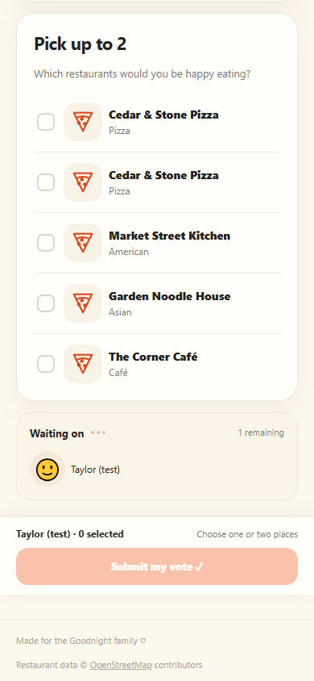
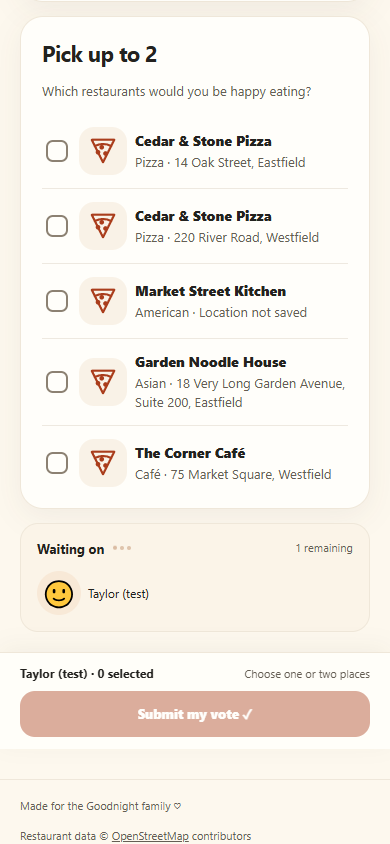
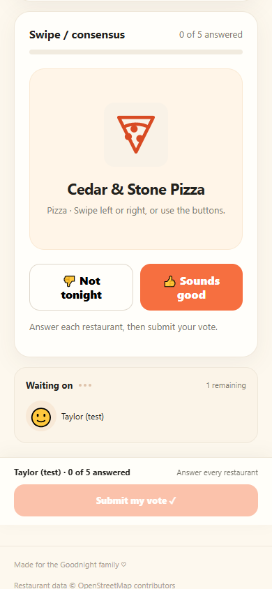
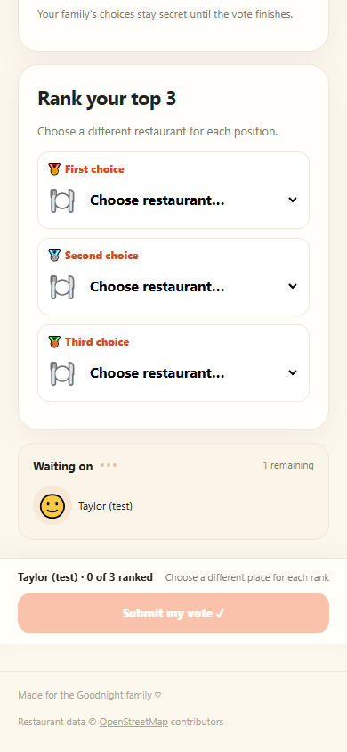
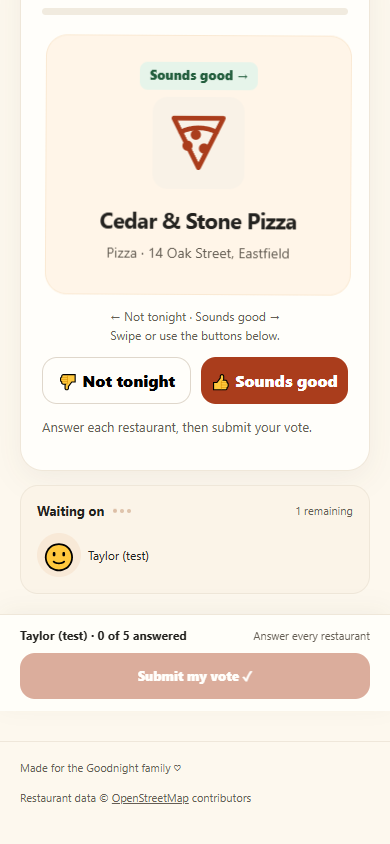
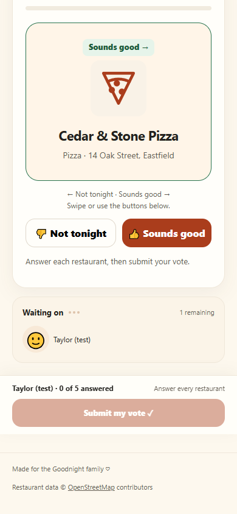

# Q1 + H3 ballot verification

Synthetic data only. Baseline is main `bb15b00`; after images show this PR. Same five fictional restaurants, member, 390×844 mobile viewport and initial unanswered ballot in each comparison. All browser requests are intercepted and fulfilled from repository files or synthetic RPC responses. No production credentials, live database, external image host or paid service is used.

| Method | Before | After |
|---|---|---|
| Approval |  |  |
| Swipe |  |  |
| Ranked |  |  |

Two identically named places now have distinct saved addresses. Missing locations say “Location not saved.” Native ranking options contain the address, selected details update in place, and a keyboard-accessible disclosure lists every place's cuisine and location. The native select nodes remain mounted during selection and duplicate-choice clearing.

| Additional state | Screenshot |
|---|---|
| Rightward drag, before committing any answer |  |
| Reduced motion: direction text, no card transform |  |
| 320px, simulated 200% text sizing | [Full screenshot](after/swipe-320-text-200.png) |

## Automated evidence

- Baseline Node suite: 63/63 passed. Final suite: 69/69 passed, including contrast, location/fallback, select-detail updates, scroll-direction lock, second-finger cancellation and mismatched-touch coverage. Existing editing, failed-save, focus and logo tests still pass.
- Contrast calculations: white primary-button text **6.19:1** (formerly **2.89:1**); muted copy on the swipe background **5.93:1** (formerly **4.09:1**). Ordinary ballot secondary text/accent labels exceed 4.5:1 across the tested cream surfaces; focus rings and checkbox boundaries exceed 3:1. Disabled controls remain visually subdued and are excluded from enabled-text contrast assertions.
- Headless Edge/Chromium with Playwright 1.62.1: approval, swipe and ranked ballots at **320, 375, 390, 430px**; landscape **844×390** and short viewport **390×420**. No horizontal overflow against the requested viewport width, including simulated 200% text sizing at 320px.
- Keyboard: Space selects approvals without losing focus; Enter answers consensus and retains button focus; Tab moves between native ranked controls. Select identity/focus and duplicate clearing are verified in the real DOM.
- Actual Chromium touch injection: vertical movement scrolls without answering; horizontal movement provides a directional text cue and restrained transform, then answers exactly once on release; cancelled gestures do not answer. Reduced-motion transform is `none`. DOM fixture tests also exercise a scroll that ends with sideways drift, a second finger and an unrelated touch identifier.
- All five consensus answers, backtracking after the final card, explicit submission, failed saves and retries for **all three voting methods**. Exact saved payloads match existing ballot semantics. Answering/revealing/backtracking makes no voting RPC; nothing saves until explicit submission.
- Broken image response shows the existing SVG fallback. Simulated 34px bottom safe-area padding leaves submit visible in landscape/short viewports. Screenshots were visually inspected for address wrapping, feedback, contrast and larger text.

## Reproduce

Normal CI remains dependency-free:

```text
node --test tests/*.test.js
```

The optional browser runner uses installed Microsoft Edge and an external Playwright installation; no package/build/runtime dependency is added to the website:

```powershell
npm install --prefix "$env:TEMP/gw-ballot-browser" --no-save --package-lock=false playwright@1.62.1
$env:GW_PLAYWRIGHT_MODULE="$env:TEMP/gw-ballot-browser/node_modules/playwright"
node tests/browser/ballots.cjs --before=bb15b00
node tests/browser/ballots.cjs
```

`GW_GIT` may point to a Git executable if it is not on PATH. `GW_BROWSER_CHANNEL` defaults to `msedge`; use `chrome` when Chrome is installed instead. The runner regenerates the screenshot files in this folder. Failed-save errors in fixtures are intentional.

## Physical and integration checks still outstanding

Real iPhone Safari and installed Home Screen mode, iOS native picker reopening, VoiceOver/TalkBack announcements, Android touch behavior, actual OS keyboard opening, actual device text-size/browser zoom settings, and real notch/home-indicator safe areas remain untested. A short viewport, doubled computed text sizes and CSS padding are simulations of those conditions. No live Supabase/multi-phone test or unassisted five-option family usability session was performed. These are staging/release checks, not a reason to modify live data during this PR.
